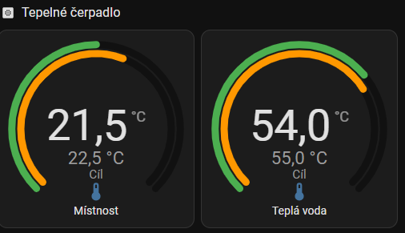

# ELCO Remocon-Net (read-only) for Home Assistant

[](https://github.com/karliklukas/ha-elco-remocon/actions/workflows/validate.yml)
[](https://hacs.xyz/docs/faq/custom_repositories/)
[](LICENSE)

Unofficial, **read-only** Home Assistant integration for ELCO heat pumps connected to the
**Remocon-Net** cloud (Ariston group, **GALEVO** controller family – e.g. *AEROTOP MONO.2* with
*REMOCON PLUS.2*). It shows what the heat pump is doing – running, heating, defrosting, heating
rods on – together with the real flow, room and hot-water temperatures. **It never writes
anything to the heat pump.**

> Not affiliated with ELCO, Ariston or Remocon-Net. The cloud API is undocumented and may change
> without notice.

## Features

- Heat pump **operating mode** – off / standby / heating / *heating with booster* / **defrost** /
  freeze protection / failure … (20 states)
- **Heat pump running**, **DHW heating rod** and **CH backup heater** on/off
- **Water temperature from the heat pump** and **CH flow temperature** (real values, not only set-points)
- Room temperature and **humidity**, DHW tank temperature, outdoor temperature (controller, heat pump sensor, online)
- Set-points, system / zone / DHW / buffer modes, pressure, signal strength
- **Electricity consumption** from the EM20 meter – heating and hot water separately, imported into
  long-term statistics for the **Energy dashboard**, plus *yesterday* / *previous month* sensors
- Config flow (UI), re-authentication, options (update interval), diagnostics
- **English, German and Czech** – entity names and states follow the Home Assistant language
  (other languages fall back to English)
- Robust polling: a failed gateway read is retried once and the last values are kept for up to
  3 failed polls in a row, so short cloud hiccups do not make everything *unavailable*

## Requirements

- Home Assistant **2025.11** or newer (the brand icon is shown from **2026.3**)
- ELCO heat pump with a Remocon-Net gateway on the **GALEVO** platform – in the
  [Remocon-Net portal](https://www.remocon-net.remotethermo.com) the plant URL contains
  `/R2/Plant/Index/`. Plants with `/R2/BsbPlantDashboard/` (BSB family) are **not** supported
  (see [thomasgregg/elco-aerotop](https://github.com/thomasgregg/elco-aerotop) for those).

## Installation

### HACS (recommended)

[](https://my.home-assistant.io/redirect/hacs_repository/?owner=karliklukas&repository=ha-elco-remocon&category=integration)

1. Click the button above (or HACS → ⋮ → **Custom repositories** → add
   `https://github.com/karliklukas/ha-elco-remocon`, type **Integration**).
2. Download **ELCO Remocon-Net (read-only)** and restart Home Assistant.
3. Add the integration and log in with your Remocon-Net e-mail and password. Leave the API URL at its default.

   [](https://my.home-assistant.io/redirect/config_flow_start/?domain=elco_remocon_ro)

   (or **Settings → Devices & services → Add integration → ELCO Remocon-Net (read-only)**)

### Manual

Copy `custom_components/elco_remocon_ro` into `<config>/custom_components/` and restart Home Assistant.

## Configuration

| Option | Default | Notes |
|---|---|---|
| Update interval | 120 s | 60–3600 s. One update = 2 cloud requests; each reads live data from the gateway (~10 s). |

## Entities

The device is named after the Home Assistant language (*Heat pump* / *Wärmepumpe* / *Tepelné čerpadlo*),
so entity IDs look like `sensor.heat_pump_room_temperature`. Names below are the English ones.

| Entity | Type | Cloud source |
|---|---|---|
| Heat pump running | binary | dataItem `IsHeatingPumpOn` |
| Hot water heating rod | binary | dataItem `IsResistorOn` |
| Heating backup heater | binary | menuItem 337 |
| Hot water boost, Quiet mode, Heat request, Holiday, Weather compensation | binary | dataItems |
| HV input 1 (SG Ready / PV) | binary, diagnostic | menuItem 304 |
| Heat pump mode | enum (translated) | menuItem 340 |
| Heat pump water temperature / Heating flow temperature | °C | menuItems 348 / 349 |
| Heating flow setpoint | °C | dataItem `ChFlowSetpointTemp` |
| Room temperature / Room humidity | °C / % | dataItem `ZoneMeasuredTemp` / menuItem 146 |
| Hot water tank temperature | °C | dataItem `DhwStorageTemperature` |
| Outdoor temperature (controller / heat pump / online) | °C | dataItem `OutsideTemp` / menuItems 341, 130 *(online disabled by default)* |
| Room, hot water and buffer comfort / economy set-points | °C | dataItems |
| System / zone / hot water / buffer tank mode | text (localized by the cloud) | dataItems |
| System pressure | bar | dataItem `HeatingCircuitPressure` |
| Heating curve offset, HV input 1 function, Signal strength | diagnostic | dataItem / menuItems 303, 119 |
| Heating / hot water consumption yesterday, … last month | kWh | consumption reports (EM20) |
| End of the latest consumption interval | timestamp, diagnostic | consumption reports (EM20) |

### Upgrading from 0.2.x

Since 0.3.0 the names come from translations. Existing entity IDs are kept, so dashboards keep working.
**The states of *Heat pump mode* and *HV input 1 function* are now keys** (`heating`, `standby`,
`defrost`, …) shown translated in the UI – automations or templates comparing them with the old Czech
texts (`Topení`, `Pohotovost`, …) have to use the keys. The mode texts sent by the cloud
(system / zone / hot water / buffer mode) now come in the Home Assistant language.

## Energy (EM20 meter)

Plants with an EM20 energy meter (`hasMetering`) also get the electricity consumed by the heat pump,
split into **heating** and **hot water**. The cloud publishes it only as reports, with a delay:

| Report | Resolution | Used for |
|---|---|---|
| last 48 hours | 2-hour buckets (end at even hours) | long-term statistics, refreshed every 30 min |
| last ~6 weeks | days, until yesterday | sensors *… consumption yesterday* |
| months | completed months | sensors *… consumption last month* |

**Energy dashboard:** *Settings → Dashboards → Energy → Individual devices → Add device* and pick the
statistics **Heat pump – heating (electricity)** and **Heat pump – hot water (electricity)**
(`elco_remocon_ro:<gateway>_ch_electricity` / `_dhw_electricity`). Each 2-hour bucket is split evenly
into its two hours, so the hourly view is approximate; daily and monthly totals are exact. Values
appear with a delay of up to ~2.5 hours. History before the first import is not backfilled.

- The first statistics rows appear up to ~45 minutes after installation (30-min poll, imports are
  skipped during the first 15 minutes after a bucket boundary).
- Reports are polled only while at least one of the energy entities is enabled – disabling all of
  them also stops the statistics import.
- *… consumption yesterday* shows the last completed day the cloud has published; early in the morning
  it may still show the day before.

> The 2-hour buckets are aligned to **local** time – verified in summer (CEST) and winter time (CET,
> a hot-water heating at 02:08 landed in the 02:00–04:00 bucket). The diagnostic sensor *End of the
> latest consumption interval* shows the end of the newest bucket.

## Dashboard example



Two gauges made with [Modern Circular Gauge](https://github.com/selvalt7/modern-circular-gauge)
(HACS). The outer ring is the measured temperature, the **inner ring is the set-point** and its
value is shown under the main value as *Target* (the screenshot shows the Czech labels):

```yaml
type: custom:modern-circular-gauge
entity: sensor.heat_pump_room_temperature
name: Room
min: 15
max: 28
unit: °C
decimals: 1
gauge_type: standard
header_position: bottom
needle: false
segments:
  - from: 15
    color: [11, 182, 239]
  - from: 21
    color: [76, 175, 80]
  - from: 24
    color: [255, 152, 0]
secondary:
  entity: sensor.heat_pump_room_target_temperature
  show_gauge: inner
  label: Target
  unit: °C
  decimals: 1
  min: 15
  max: 28
  state_size: small
grid_options:
  columns: 6
  rows: 4
```

```yaml
type: custom:modern-circular-gauge
entity: sensor.heat_pump_hot_water_tank_temperature
name: Hot water
min: 30
max: 65
unit: °C
decimals: 1
gauge_type: standard
header_position: bottom
needle: false
adaptive_state_color: false
segments:
  - from: 30
    color: [11, 182, 239]
  - from: 46
    color: [76, 175, 80]
  - from: 56
    color: [255, 152, 0]
secondary:
  entity: sensor.heat_pump_hot_water_target_temperature
  show_gauge: inner
  label: Target
  unit: °C
  decimals: 1
  min: 30
  max: 65
  state_size: small
grid_options:
  columns: 6
  rows: 4
```

Real and requested flow temperature in one tile – a template helper
(*Settings → Helpers → Template → Sensor*) with this state template:

```jinja


{{ '%.1f' % (a|float) }} °C · target {{ '%.1f' % (t|float) }} °C—
```

## Troubleshooting

- **Everything unavailable for a few minutes** – the gateway sometimes answers
  `Gateway error … InternalError`. The integration retries and keeps the last values for 3 polls;
  longer outages are reported. Running another integration that polls the same gateway
  (e.g. the Ariston integration) increases the load – prefer one.
- **Debug logging**:
  ```yaml
  logger:
    logs:
      custom_components.elco_remocon_ro: debug
  ```
- **Diagnostics**: *Settings → Devices & services → ELCO Remocon-Net → ⋮ → Download diagnostics*
  (credentials, gateway ID and location are redacted).

## How it works

- `dataItems` – named values (`POST remote/dataItems/{gateway}/get`). Unknown IDs are silently ignored by the cloud.
- `menuItems` – numbered controller parameters (`GET menuItems/{gateway}?menuItems=…`).
  **A single unsupported number fails the whole request (HTTP 500)**, so only numbers verified on a
  real plant are requested (`MENU_IDS` in `const.py`; known crashers are listed there).
- If your controller differs, run the read-only probe first and open an issue with the
  (anonymised) results:
  ```
  python tools/probe.py --gateway <GATEWAY_ID>
  ```
  The probe output contains account and location data – **do not publish it as is**.

## Development

```
pip install aiohttp pytest pytest-asyncio
pytest
```

The tests cover the HA-independent parts (API client against a fake cloud, value mapping, energy
buckets) and check that every entity and enum state is translated in all languages.
CI runs the HACS validation, hassfest and the tests on every push.

Releases follow the `version` in `manifest.json` (`vX.Y.Z` tags). HACS offers updates per release.

## License

[MIT](LICENSE) © 2026 Lukas Karlik

---

### Česky ve zkratce

Neoficiální integrace **jen pro čtení** pro tepelná čerpadla ELCO v cloudu Remocon-Net (řízení
GALEVO, např. AEROTOP MONO.2). Ukazuje, co čerpadlo dělá – běží, topí, odmrazuje, spínají spirály –
a skutečné teploty výstupu, místnosti a teplé vody. Do čerpadla nic nezapisuje. Instalace přes HACS
jako vlastní repozitář, přihlášení stejným e-mailem a heslem jako v aplikaci Remocon-Net. Názvy a stavy
entit jsou česky, anglicky nebo německy podle jazyka Home Assistantu.
